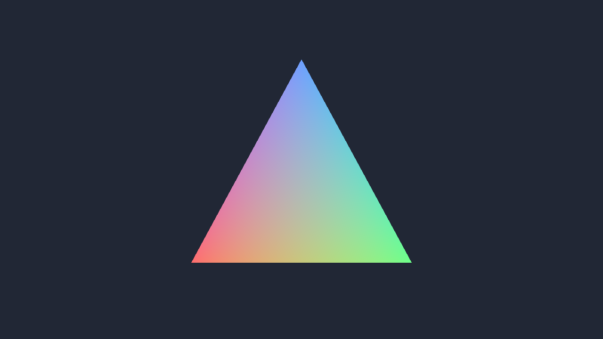

# VulkanUS

Небольшая основа рендерера на **Rust + ash + GLFW + Vulkan Memory Allocator**. При запуске открывается окно с цветным треугольником. Вершины загружаются через staging-буфер в VMA-буфер; используются Vulkan 1.3, dynamic rendering и synchronization2.



## Запуск

Нужны Rust **1.85+**, CMake, компилятор C/C++ и драйвер с поддержкой Vulkan 1.3. GLFW и VMA собираются из исходников через Cargo. Шейдеры GLSL автоматически компилируются в SPIR-V через Naga в `build.rs` и встраиваются в исполняемый файл: отдельный `glslc` и Vulkan SDK для обычной сборки не требуются.

### Windows

Установи Rust с MSVC toolchain, **Visual Studio Build Tools** с компонентами «Desktop development with C++» и Windows SDK, а также CMake с добавлением в `PATH`. Обнови драйвер видеокарты. Из терминала в каталоге проекта:

```powershell
cargo run --locked --release
```

Для validation layers установи Vulkan SDK, затем запусти `cargo run --locked -- --validation`.

### Linux (Ubuntu / Debian, X11 или XWayland)

```sh
sudo apt-get install build-essential cmake pkg-config libx11-dev libxrandr-dev libxinerama-dev libxcursor-dev libxi-dev libvulkan1
cargo run --locked --release
```

Дополнительно для программного Vulkan и диагностики:

```sh
sudo apt-get install mesa-vulkan-drivers vulkan-validationlayers
cargo run --locked -- --validation
```

Нужен доступный графический сеанс (`DISPLAY`). В этой конфигурации GLFW использует X11; в Wayland нужен XWayland. macOS/MoltenVK не является целевой платформой этой версии.

**Escape** и кнопка закрытия завершают приложение.

## Архитектура

| Модуль | Ответственность |
| --- | --- |
| `app` | Главный цикл, события, порядок завершения, smoke test |
| `window` | GLFW, окно без OpenGL-контекста, размеры framebuffer |
| `graphics/instance` | Vulkan loader, instance, debug messenger, счётчик ошибок validation |
| `graphics/surface` | Поверхность GLFW/Vulkan |
| `graphics/device` | Выбор подходящего GPU, проверка и включение features, очереди |
| `graphics/buffer` | VMA, типизированные вершины, staging upload, освобождение allocations |
| `graphics/swapchain` | Формат, extent, изображения, image views и семафоры presentation |
| `graphics/pipeline` | Шейдеры, vertex layout и graphics pipeline |
| `graphics/frame` | Command pool, command buffer, acquire semaphore и fence одного кадра |
| `graphics/renderer` | Координация acquire → record → submit → present, resize |

Ресурсы освобождаются через `Drop`, в том числе при неполной инициализации. `Rc` удерживает владельцев: buffer → VMA → device → surface → instance → loader. Renderer ждёт GPU перед освобождением ресурсов; приложение уничтожает renderer раньше GLFW-окна. Vulkan-вызовы и `unsafe` сосредоточены в `graphics`.

Два кадра могут находиться в полёте. У каждого кадра свои command pool, acquire semaphore и fence. Render-finished semaphore принадлежит **изображению swapchain**: frame fence не гарантирует завершение presentation. Неизменяемый vertex buffer общий для кадров. Ожидание всего устройства выполняется при пересоздании swapchain и завершении, а не на каждом кадре.

При `OUT_OF_DATE` swapchain пересоздаётся; fence сбрасывается только перед готовым submit, поэтому пропущенный кадр не создаёт deadlock. `SUBOPTIMAL` разрешает показать кадр и повторно проверить параметры поверхности: одинаковая конфигурация не вызывает бесконечного пересоздания. Изменение формата пересоздаёт pipeline; изменение размера обновляет viewport/scissor. При нулевом framebuffer или свёрнутом окне приложение обрабатывает события и ждёт восстановления. Квадратный viewport сохраняет пропорции треугольника.

## Проверка

```sh
cargo fmt --all -- --check
cargo clippy --locked --all-targets -- -D warnings
cargo test --locked
cargo run --locked -- --validation --smoke-test
```

`--smoke-test` рисует 180 кадров, несколько раз изменяет размеры окна и вызывает minimize/restore. Для фактической обработки сворачивания нужен оконный менеджер; под обычным Xvfb проверяются рендер и resize. `--frames N` завершает приложение после N показанных кадров. Любая ошибка Vulkan validation, включая освобождение ресурсов, приводит к ненулевому коду возврата. В debug-сборке validation включается автоматически, если слой доступен; `--validation` требует его наличия, `--no-validation` выключает.

Для проверки синхронизации в Linux:

```sh
VK_LAYER_ENABLES=VK_VALIDATION_FEATURE_ENABLE_SYNCHRONIZATION_VALIDATION_EXT cargo run --locked -- --validation --smoke-test
```

Тесты проверяют выбор очередей, ограничения extent/image count, выбор формата и аргументы запуска. CI собирает и проверяет проект на Linux/Windows и запускает Vulkan smoke test на Mesa Lavapipe под Xvfb.

Основа намеренно ограничена одним проходом и vertex buffer: depth, текстуры, descriptors, ECS и render graph можно добавлять отдельными слоями по мере необходимости.
